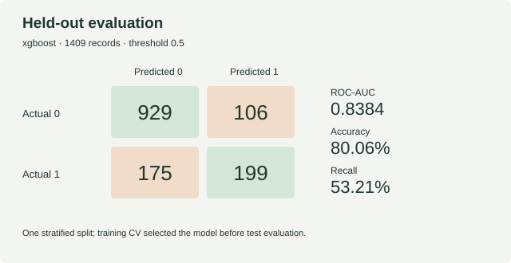

# Telecom churn prediction

[](https://github.com/yousufpatel41-collab/telecom-churn/actions)

A portfolio project using IBM's sample Telco Customer Churn dataset. A fitted preprocessing pipeline and XGBoost classifier predict churn; FastAPI serves the same pipeline.

## Run locally

Use Python 3.11 or 3.12 in a virtual environment. From the repository root:

```shell
pip install -r requirements.txt
python src/download_data.py
python src/train.py
python src/build_evaluation_report.py
python -m unittest discover -s tests
uvicorn api:app --app-dir src
```

Open http://127.0.0.1:8000/docs for the request schema and interactive examples. The API returns HTTP 503 until a locally trained model exists. Train again after upgrading dependencies; only load model files you created yourself.

## Evaluation

Training reserves a stratified 20% test set before fitting imputers or category encoders. Five-fold cross-validation fits preprocessing inside each training fold. The final model uses a 0.5 classification threshold. `outputs/metrics.json` records the dataset checksum, split sizes, cross-validation scores and held-out metrics from the latest run.

Training saves the complete fitted pipeline to `models/churn_pipeline.pkl`. Both API endpoints pass raw customer features to that pipeline. Categories are never fitted again during prediction, and blank TotalCharges values are imputed using training data.

The API's monthly revenue-at-risk field is MonthlyCharges multiplied by predicted churn probability. It is a scenario estimate in the source data's unspecified currency. It is not realised savings, a causal retention estimate, or an employer result. Risk tiers and suggested actions are illustrative rules.

## Files

- `src/download_data.py`: downloads the sample CSV from IBM's public repository.
- `src/preprocess.py`: shared data preparation and fitted preprocessing.
- `src/train.py`: training, evaluation and pipeline export.
- `src/api.py`: health, single prediction and batch prediction endpoints.
- `tests/test_pipeline.py`: category encoding and API prediction consistency checks.
- `outputs/metrics.json`: results generated by the training script.

No Power BI dashboard or EDA notebook is included. Earlier charts were removed because their results could not be reproduced from the committed training code.

Dataset: [IBM Telco Customer Churn](https://github.com/IBM/telco-customer-churn-on-icp4d/blob/master/data/Telco-Customer-Churn.csv). This project is not affiliated with IBM or Vodafone.

## Reproduced results

Held-out set: 1,409 records; threshold 0.5.

| ROC-AUC | Accuracy | Precision | Recall | F1 |
|---:|---:|---:|---:|---:|
| 0.8384 | 80.06% | 65.25% | 53.21% | 58.62% |

Training five-fold ROC-AUC: 0.8409 ± 0.0079. These describe one sample split; external validity and retention impact have not been measured.

## Licence and data rights

Project code and documentation: [MIT](LICENSE). External datasets retain their own terms; see [DATA_SOURCES.md](DATA_SOURCES.md).

## Evaluation chart



Recreate this chart with `python src/build_evaluation_report.py` after training. It displays recorded holdout counts; it is not a SHAP or feature-importance plot.
